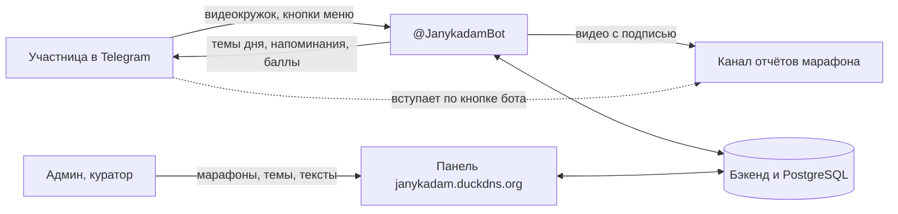
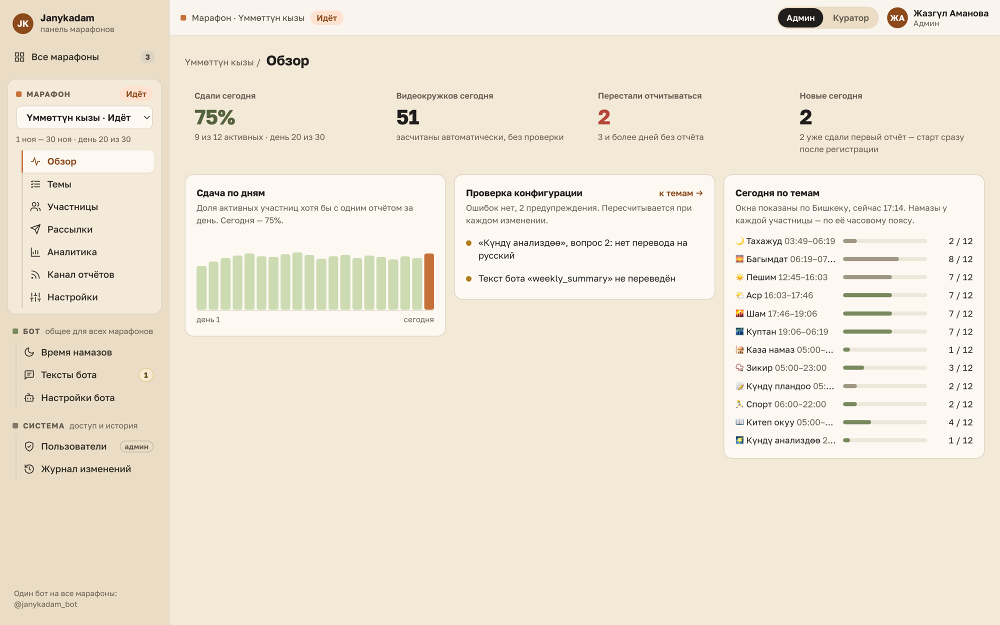
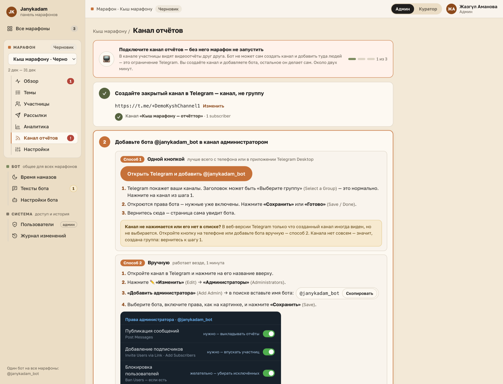

# Janykadam — Telegram-бот марафонов

Telegram-бот **[@JanykadamBot](https://t.me/JanykadamBot)** ведёт 30-дневные
марафоны сообщества Janykadam: участницы каждый день отчитываются видеокружком
о намазах и своих темах, а бот считает окна по их городу, напоминает, начисляет
баллы и выкладывает отчёты в канал марафона. Организаторы управляют всем из
веб-панели.

## Ссылки

| | |
| --- | --- |
| Бот | [@JanykadamBot](https://t.me/JanykadamBot) — участница входит по ссылке марафона `https://t.me/JanykadamBot?start=<код>` |
| Админ-панель (прод) | **https://janykadam.duckdns.org** — вход через Telegram, только для админов и кураторов из списка |
| Состояние сервера | https://janykadam.duckdns.org/healthz — `{"ok":true,"db":"up","queue":"up"}`, когда всё работает |

Один бот обслуживает все марафоны сразу: код в ссылке говорит, в какой
марафон записать. Ссылку для входа и код марафона показывает панель.

## Как это устроено



## Бот в Telegram

**Вход.** Участница открывает ссылку марафона и нажимает «Старт». Бот не может
написать первым — поэтому только так.

1. Язык — кыргызский или русский. Все кнопки и тексты дальше на нём.
2. Место — город из списка, поиск по названию или геолокация (бот берёт
   ближайший город). По месту бот считает время намазов и часовой пояс.
3. Правила марафона — без согласия записи нет.
4. Цель — своими словами, её можно отложить.
5. Приветствие с темами, открытыми прямо сейчас, и кнопка в канал марафона.

**Отчёт** — только видеокружок. Бот сам относит его к открытой теме (намаз или
своя тема марафона), а если открыто несколько — спрашивает, к какой. Потом
задаёт вопросы темы и начисляет баллы. Видео не проверяется: отправка в
открытое окно и есть принятый отчёт.

**Меню** — шесть кнопок:

| Кнопка | Что делает |
| --- | --- |
| 🎥 Отчёт тапшыруу | Какие темы открыты сейчас и до скольки; если ни одной — когда откроется следующая |
| ✅ Отчётторум | Все темы дня с окнами и отметками: сдано, идёт, пропущено, узур |
| 🤲 Максаттарым | Цель участницы, её можно переписать |
| 😎 Өзүм жөнүндө | Рейтинг (пятёрка лучших и своё место), цель, кнопка «🤍 узур күнү» — сегодняшние намазы можно не сдавать |
| 🕐 Убакыт алкагы | Сменить город и часовой пояс |
| ❓ Жардам | Как всё работает |

Команды: `/start`, `/otchet`, `/ball`, `/marafon`, `/pauza`, `/zona`, `/til`,
`/tahajjud`, `/help`.

**Напоминания** приходят при открытии каждой темы; попавшие в тихие часы
(по умолчанию 22:30–04:30) сдвигаются на их конец. Тахажуд — только тем, кто
включил его командой `/tahajjud`. По желанию марафона — утренняя и вечерняя
сводки.

**Канал отчётов.** У каждого марафона свой закрытый Telegram-канал. Бот
впускает туда только участниц марафона и выкладывает каждый принятый отчёт
видео с подписью: тема, имя, город, день марафона. Исключённых из марафона бот
из канала убирает.

## Админ-панель

https://janykadam.duckdns.org — вход через Telegram Login, без пароля.

- Марафоны: создание и копирование — обязательно со ссылкой на свой канал
  отчётов, проверка конфигурации перед запуском.
- Темы: намазы и свои темы с окнами, баллами и вопросами.
- Участницы: вкладки по статусу, баллы, уважительные дни, цель, экспорт в CSV.
- Канал отчётов: пошаговое подключение бота с живой проверкой каждого шага.
- Рассылки по сегментам, аналитика, журнал изменений.
- Бот: все тексты на двух языках, тихие часы, лимит напоминаний, команды.

Обзор идущего марафона: доля сдавших, отчёты по дням, проверка конфигурации и
сдача по каждой теме сегодня.



Подключение канала отчётов: панель ведёт по шагам и сама отмечает готовые —
ссылка проверена, дальше бот добавляется администратором кнопкой или вручную.



Снимки сделаны на демо-данных (`VITE_USE_SEED=true`), имена выдуманы.

## Структура репозитория

| Папка | Что это |
| --- | --- |
| [`telegram-bot/`](telegram-bot/) | Бот и бэкенд панели: Node 22, NestJS, grammY, PostgreSQL 16 через Drizzle, очереди pg-boss. |
| [`admin-panel/`](admin-panel/) | Админ-панель: React 19, TypeScript, Vite. |
| [`deploy/`](deploy/) | Прод-стенд: Docker Compose, Caddy, панель и API на одном домене, резервные копии. |

## С чего начать

- Бот и бэкенд: [`telegram-bot/README.md`](telegram-bot/README.md) — запуск,
  BotFather, справочник городов, тесты, устройство канала отчётов.
- Панель: [`admin-panel/README.md`](admin-panel/README.md).
- Сервер: [`deploy/README.md`](deploy/README.md) — развёртывание, обновление,
  резервные копии.

Быстро посмотреть панель на демо-данных, без бэкенда:

```bash
cd admin-panel && npm install && VITE_USE_SEED=true npm run dev
```

## Документы

- [`telegram-bot/DECISIONS.md`](telegram-bot/DECISIONS.md) — принятые решения и найденные в спецификации расхождения
- [`ADMIN_PANEL_PROMPT.md`](ADMIN_PANEL_PROMPT.md) — исходное задание на панель
- [`DESIGN_PROMPT.md`](DESIGN_PROMPT.md), [`CLAUDE_DESIGN_PROMPT.md`](CLAUDE_DESIGN_PROMPT.md) — исходные задания на дизайн бота

Данные о городах: GeoNames (CC BY 4.0), https://www.geonames.org/
