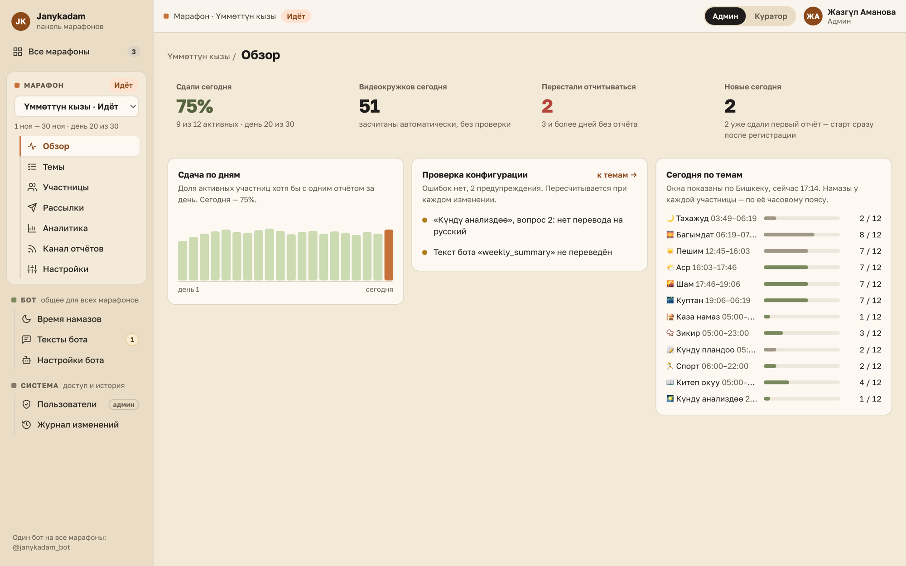

# Janykadam — панель марафонов

Админ-панель бота [janykadam](../telegram-bot): марафоны, темы, участницы,
канал отчётов, рассылки, тексты бота. React 19, TypeScript, Vite. Сборка —
статика, её можно положить на любой хостинг.



## Экраны

**Марафон:** обзор (с проверкой конфигурации и запуском набора), темы и
вопросы, участницы, рассылки, аналитика, канал отчётов, настройки (даты,
баллы, правила марафона, ссылка для входа).

**Бот — общее для всех марафонов:** время намазов, тексты бота на двух
языках, настройки бота (тихие часы, лимит напоминаний, команды, описание).

**Система:** пользователи панели (только админ) и журнал изменений.

Что стоит знать:

- **Новый марафон и копия** создаются только со ссылкой на Telegram-канал
  отчётов. Панель проверяет ссылку на лету — канал ли это, а не группа, — и
  показывает название канала. После создания открывается страница «Канал
  отчётов».
- **Канал отчётов** — пошаговая настройка: канал (не группа) → бот
  администратором, кнопкой или вручную, с картинкой нужных прав → проверка прав
  → приватность. Страница сама опрашивает бэкенд каждые несколько секунд и
  отмечает готовые шаги. Без готового канала марафон не запустить.
- **Участницы** открываются на вкладке «Активные»; рядом «На паузе», «Вышли»,
  «Завершили» и «Все» с числами. Карточка участницы — цель, согласие с
  правилами, окна дня, история баллов.

## Запуск

Нужен поднятый бэкенд. В его `.env` должен быть `ADMIN_ORIGIN=http://localhost:5173`,
иначе браузер зарежет запросы из панели.

```bash
cp .env.example .env
```

```bash
npm install && npm run dev
```

Без бэкенда панель умеет работать на фикстурах: поставьте `VITE_USE_SEED=true`.
Данные при этом никуда не сохраняются — это режим для вёрстки.

## Переменные окружения

| Переменная | Смысл |
| --- | --- |
| `VITE_API_URL` | Адрес бэкенда. Пустая строка — тот же origin. |
| `VITE_BOT_USERNAME` | Username бота без `@` — нужен виджету входа. |
| `VITE_USE_SEED` | `true` — работать на локальных фикстурах. |

## Вход

Пароля нет. Telegram Login Widget подписывает данные токеном бота, бэкенд
проверяет подпись и ищет username в списке пользователей панели. Отсюда два
условия:

1. В BotFather задан `/setdomain` с доменом панели. Без этого виджет не
   появится — он отказывается работать на незарегистрированном домене.
2. Этот username есть в `admin_users`. Первого админа заводит сид бэкенда из
   `INITIAL_ADMIN_TG_USERNAME`, остальных добавляют в разделе «Пользователи».

Сессия лежит в httpOnly-куке `jk_admin` с `SameSite=Lax`, поэтому **панель и API
должны быть на одном сайте**: `localhost:5173` и `localhost:3000` — это один
сайт, а `panel.netlify.app` и `api.example.com` — разные, и кука туда не уйдёт.
Рабочая схема для продакшена — поддомены одного домена: `panel.example.com` и
`api.example.com`. Для действительно разных доменов понадобится
`SameSite=None; Secure`, которого в бэкенде пока нет.

## Как устроено

```
src/
  api/        клиент, типы ответов, перевод в модель панели, загрузка
  data/       справочники, пустое состояние, фикстуры
  lib/        время, окна тем, превью сообщения, производные выборки
  store/      состояние и действия
  screens/    15 экранов и вход
  components/ общие части интерфейса
```

`api/map.ts` — единственное место, где встречаются имена бэкенда и имена
панели: у бота `startDate` и `excusedDays`, у панели `start` и `excused`.
Экраны про API не знают вовсе.

Данные грузятся по одному марафону: открыли — загрузили. Карточка «Все
марафоны» показывает остальные по сводке из списка, иначе пришлось бы тянуть
участниц всех марафонов сразу.

Формы — марафон, тема, вопрос, тексты и настройки бота — сохраняются кнопкой.
Первая правка снимает снимок значений и показывает внизу панель «Сохранить /
Отменить» (`Ctrl/⌘+S` тоже сохраняет); уходит один `PATCH` только с
изменёнными полями, «Отменить» возвращает снимок. Уйти со страницы, сменить
марафон или закрыть вкладку с несохранённым панель не даст молча — спросит.
Действия со структурой (добавить или удалить тему, вопрос, вариант) сначала
сохраняют открытую правку.

Если запрос не прошёл, панель показывает причину и перезагружает данные:
лучше вернуть правду, чем оставить на экране то, чего в базе нет.

## Время намазов

Время намазов и список мест приходят из `/api/prayer/presets` — бот считает их
сам, пакетом `adhan`, без обращений к API в работе. В панели они лежат в
реестре `data/constants.ts`, потому что расчёты окон в экранах синхронные.

Пояса мало: Бишкек и Ош лежат в `Asia/Bishkek`, но расходятся на 5–15 минут.
Поэтому в таблице времён строки по местам, а не по поясам, а точные окна
конкретной участницы считает бэкенд по её координатам — панель показывает их в
её карточке.

## Сборка

```bash
npm run build
```

Готовая статика лежит в `dist`. На хостинге нужен редирект всех путей на
`index.html`, иначе клиентские маршруты будут отдавать 404.

## Тексты бота

Все тексты бота — на русском и кыргызском — правятся на экране «Тексты бота»:
строка раскрывается в редактор с подсказкой плейсхолдеров (`{имя}`,
`{тема}`…). Непереведённые тексты помечены и попадают в проверку
конфигурации. Надписи кнопок главного меню и подпись под видео в канале —
тоже здесь.
